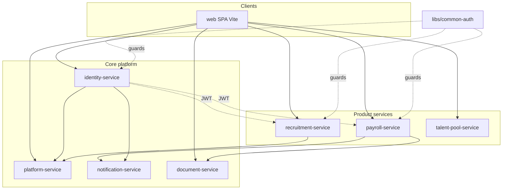

# E-Watu ERP — Architecture

Multi-tenant HR ERP sold **module by module**. This document describes the **current** system and the **target** modular shape. Implementation follows [ADRs](./adr/001-modular-evolution.md).

## Current deployment (as built)



| Service | Port (dev) | Database | Product modules hosted |
|---------|------------|----------|----------------------|
| identity-service | 3011 | identity_db | Core (auth, users) |
| platform-service | 3012 | platform_db | Core (tenants, onboarding) |
| notification-service | 3015 | notifications_db | Core |
| document-service | 3018 | — (MinIO) | Core |
| payroll-service | 3016 | payroll_db | HR Employee, Leave, Payroll, Performance |
| recruitment-service | 3013 | recruitment_db | Recruitment |
| talent-pool-service | (see service README) | talent_pool_db | Talent Pool |
| web | 5173 | — | All UI routes |

**Integration today:** synchronous HTTP with `INTERNAL_API_KEY` between services; shared JWT (`tenant_id`, roles, permissions). **Not yet:** central API gateway, outbox/event bus, per-tenant module entitlements.

## Multi-tenancy

- PostgreSQL **per service**, rows scoped by **`tenant_id`** in application code (Prisma).
- Tenant lifecycle on platform-service (`ACTIVE`, `SUSPENDED`, `EXPIRED`, …) enforced via `TenantStatusGuard` in `common-auth`.
- PostgreSQL RLS: planned (see ADR-001); not enabled yet.

## Auth / RBAC

- Custom identity-service (email/password, JWT).
- Roles and permission templates in `libs/common-auth` (`EwatuRolePermissions`); embedded in JWT for guards.

## Target modular model

Logical modules are defined in **`libs/module-sdk`** (`MODULE_CATALOG`). Each module has:

- Manifest (permissions, menus, events, dependencies)
- Optional **tenant entitlement** (Phase 1, platform-service)
- **Host service** (may change when modules are extracted)

**Rules (enforced over time):**

1. No direct imports of another module’s infrastructure or DB models.
2. Cross-module lifecycle via **versioned domain events** (outbox) or **published HTTP APIs**.
3. Disabled module → no routes/menus and API returns `403 MODULE_DISABLED`.

## Payroll-service internal split (planned)

Same database initially; folders under `services/payroll-service/src/modules/`:

- `employee/`, `leave/`, `payroll/`, `performance/`

Each subfolder owns controllers/services for that module; cross-module calls go through facades only.

## Local development

```bash
npm run db:up          # Postgres, MinIO, Mailpit
npm run db:prepare     # generate, migrate all, seed dev
npm run dev            # core + payroll + recruitment + web
npm run check:dev      # smoke check when stack is up
```

Details: [services/platform-service/FLOW.txt](../services/platform-service/FLOW.txt).

## Related docs

- [Capabilities API (Phase 1 design)](./capabilities-design.md)
- [Module index](./modules/README.md)
- [ADR 001 — Modular evolution](./adr/001-modular-evolution.md)
